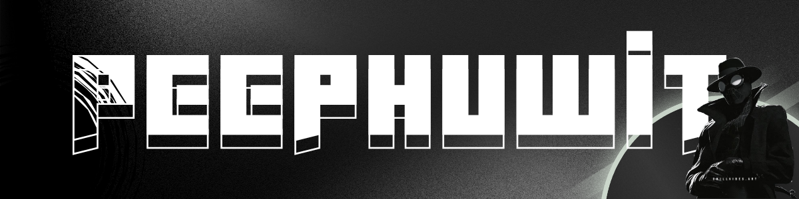

  

  >--;--<<Creative+Designer>>--"
    alt="Animated introduction"
  />

  <!-- Gmail -->
  
  &nbsp;&nbsp;
  
  <!-- Instagram -->
  
  &nbsp;&nbsp;
  
  <!-- Discord -->
  
  &nbsp;&nbsp;
  

  
---

### <code>>> PORTFOLIO Website :</code>
 <!-- Portfolio Website -->
  
  

---

### <code>>> Tech Stack :</code>

<table align="center" width="100%">
  <thead>
    <tr>
      <th align="center" width="25%">Languages</th>
      <th align="center" width="25%">Frontend & UI</th>
      <th align="center" width="25%">Backend & Database</th>
      <th align="center" width="25%">DevOps & Tools</th>
    </tr>
  </thead>
  <tbody>
    <tr>
      <!-- Languages (6) -->
      <td align="center">
        
      </td>
      <!-- Frontend & UI (5) -->
      <td align="center">
        
      </td>
      <!-- Backend & Database (6) -->
      <td align="center">
        
      </td>
      <!-- DevOps & Tools (5) -->
      <td align="center">
        
      </td>
    </tr>
  </tbody>
</table>

---

### <code>>> Game :</code>

  <!-- 1. เกม Pac-Man -->
  <picture>
    <source media="(prefers-color-scheme: dark)" srcset="https://raw.githubusercontent.com/peephuwit/Peephuwit/output/pacman-contribution-graph-dark.svg">
    <source media="(prefers-color-scheme: light)" srcset="https://raw.githubusercontent.com/peephuwit/Peephuwit/output/pacman-contribution-graph.svg">
    
  </picture>

